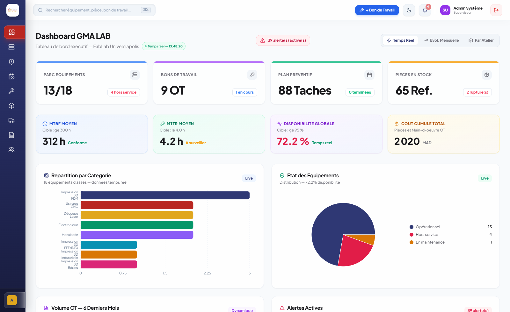
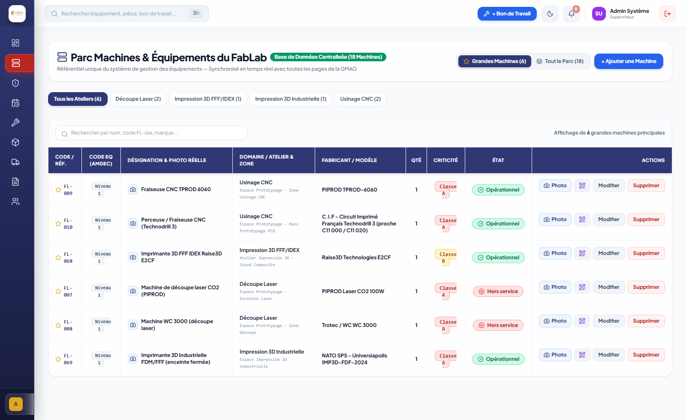
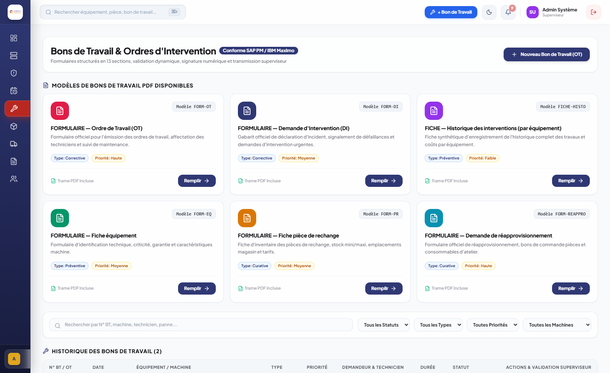
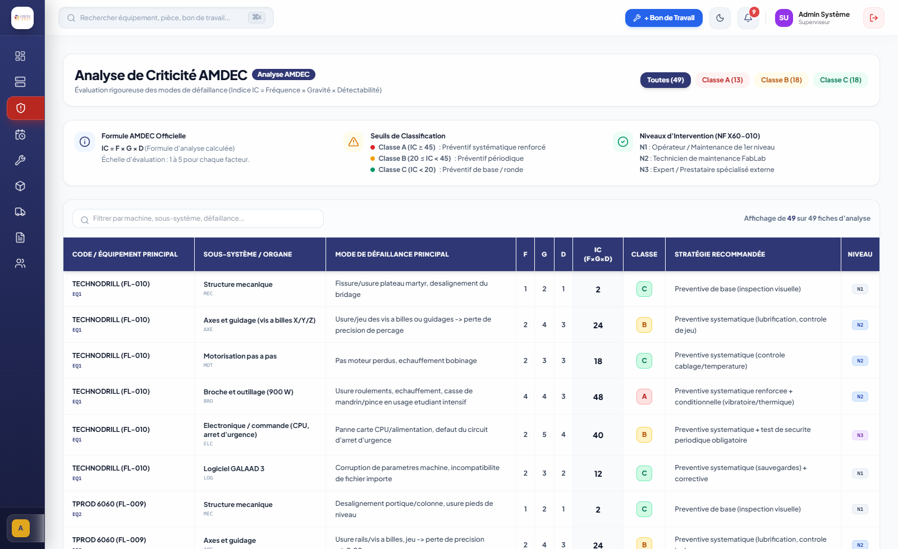

# GMA LAB — Solution GMAO Web Full-Stack

> **Application sur mesure de Gestion de Maintenance Assistée par Ordinateur (GMAO) pour le parc matériel et les consommables du Fab Lab Universiapolis.**

[](https://react.dev/)
[](https://www.typescriptlang.org/)
[](https://nodejs.org/)
[](https://expressjs.com/)
[](https://www.prisma.io/)
[](https://www.sqlite.org/)
[](https://openai.com/)
[](https://universiapolis.ma/)

---

## 🏛️ Contexte & Origine du Projet

**GMA LAB** est une application web d'ingénierie logicielle conçue, développée et déployée lors d'un stage de fin d'année au sein du **Fab Lab Universiapolis – École Polytechnique d’Agadir**, sous l’encadrement de **M. El Mehdi KIBBOU**.

L'objectif principal était de digitaliser intégralement la gestion de maintenance du parc d'équipements de haute technologie du Fab Lab (imprimantes 3D résine SLA et filaire FDM, machines de découpe laser CO2, fraiseuses à commande numérique CNC, bancs électroniques et menuiserie) et d'automatiser le suivi des consommables et pièces de rechange.

* **Démo Web en ligne** : [https://mohammed-aichour.github.io/FAB-LAB/](https://mohammed-aichour.github.io/FAB-LAB/)
* **Déploiement Vercel** : [https://fab-lab-eight.vercel.app](https://fab-lab-eight.vercel.app)

---

## 📸 Aperçu de l'Application

### 1. Tableau de bord Exécutif (KPIs Temps Réel)
Suivi en direct du taux de disponibilité global, du MTBF (Mean Time Between Failures), du MTTR (Mean Time To Repair), des coûts cumulés en MAD, et répartition par atelier.



### 2. Inventaire & Fiches Équipements
Visualisation détaillée des 18 équipements critiques, historique des interventions, états opérationnels et spécifications techniques.



### 3. Bons de Travail & Maintenance Corrective
Gestion des ordres de travail (OT), assignation aux techniciens et génération automatisée de bons d'intervention officiels en PDF via `pdf-lib`.



### 4. Matrice de Criticité & Analyse AMDEC
Gestion préventive rigoureuse selon les méthodes AMDEC pour anticiper les pannes et planifier les gammes de maintenance.



---

## ✨ Fonctionnalités Majeures Implémentées

- **Tableau de Bord Exécutif & Indicateurs KPIs** :
  - **MTBF** (Temps moyen entre pannes) et **MTTR** (Temps moyen de réparation) calculés en temps réel.
  - Taux de disponibilité global et suivi des coûts cumulés (pièces et main-d'œuvre).
  - Graphiques dynamiques sous **Recharts** (histogrammes, camemberts, évolution mensuelle).

- **Gestion du Parc Équipements** :
  - Fiches machines complètes (Imprimantes 3D SLA/FDM, Découpe laser, CNC, Atelier bois & électronique).
  - États machine temps réel (`Opérationnel`, `En maintenance`, `Hors service`).

- **Gestion des Bons de Travail (OT)** :
  - Création, planification et clôture des tickets d'intervention.
  - **Génération automatisée de Bons de Travail PDF** avec `pdf-lib` prêts pour impression et archivage.

- **Maintenance Préventive & Planification** :
  - Matrice de criticité (A-B-C) et planification des gammes de révision périodiques.
  - Alertes automatiques d'échéance de maintenance.

- **Gestion des Stocks & Pièces de Rechange** :
  - Répertoire complet des pièces et consommables (résine, filaments, buses, lentilles laser, fraises).
  - Seuils de réapprovisionnement et alertes automatiques de rupture de stock.

- **Assistant IA Conversationnel Sécurisé** :
  - Intégration de l'**API OpenAI (Function Calling)** pour guider les techniciens lors des diagnostics de pannes.
  - **Garde-fous de sécurité** : confirmation explicite en 2 étapes requise avant toute modification ou création en base de données.

- **Traçabilité & Journal d'Audit** :
  - Journalisation complète des actions administratives et techniques avec horodatage strict.

---

## 🏗️ Architecture & Modélisation des Données

Le projet a fait l'objet d'une analyse fonctionnelle rigoureuse en amont du développement :

* **Modélisation Conceptuelle & Relationnelle** : Réalisée sous **PowerAMC / PowerDesigner** comprenant un MCD et un MLD relationnel normalisé de **11 tables** (Équipements, Interventions, Techniciens, Pièces, Fournisseurs, AMDEC, Gammes, Stocks, Logs, etc.).
* **Diagrammes UML** : Cas d'utilisation, diagrammes de classes, de séquence et diagrammes de flux de données (DFD).
* **Persistance & Accès Données** : API REST développée sous **Node.js / Express** exploitant l'ORM **Prisma** avec typage de bout en bout et base de données relationnelle **SQLite** (`dev.db`).

```
FAB-LAB/
├── frontend/             # Application cliente React 19 + TypeScript (Vite + Tailwind CSS)
│   ├── src/
│   │   ├── components/   # Composants modulaires (Dashboard, Machines, OT, Stock, etc.)
│   │   ├── services/     # Appels API REST et gestion d'état
│   │   └── types/        # Interfaces TypeScript
│   └── package.json
├── backend/              # API REST Node.js / Express
│   ├── prisma/           # Schéma relationnel Prisma ORM et migrations
│   ├── src/              # Contrôleurs, routes, middlewares et connecteur OpenAI
│   ├── dev.db            # Base de données relationnelle SQLite
│   └── package.json
├── app_screenshots/      # Captures d'écran haute résolution de l'application
└── docs/                 # Documentation technique et livrables de modélisation
```

---

## 🚀 Installation & Lancement Local

### Prérequis
* Node.js (version 18 ou supérieure)
* npm ou yarn

### 1. Cloner le dépôt
```bash
git clone https://github.com/Mohammed-aichour/FAB-LAB.git
cd FAB-LAB
```

### 2. Démarrer le Backend
```bash
cd backend
npm install
npx prisma generate
npm run dev
# L'API démarre sur http://localhost:5000 (ou port configuré)
```

### 3. Démarrer le Frontend
```bash
cd ../frontend
npm install
npm run dev
# L'interface est accessible sur http://localhost:5173
```

### Configuration des Variables d'Environnement
* Créez un fichier `.env` dans `backend/` à partir de `.env.example` :
  ```env
  DATABASE_URL="file:./dev.db"
  PORT=5000
  OPENAI_API_KEY="votre_cle_api_openai_optionnelle"
  ```

---

## 👤 Auteur & Crédits

* **Développeur & Concepteur** : **Mohammed AICHOUR** — Élève Ingénieur en Génie Informatique, École Polytechnique d’Agadir – Universiapolis (Option Cybersécurité & Réseaux).
* **Encadrant de Stage** : **M. El Mehdi KIBBOU** — Responsable Fab Lab Universiapolis.
* **Institution** : École Polytechnique d’Agadir – Universiapolis, Maroc.
